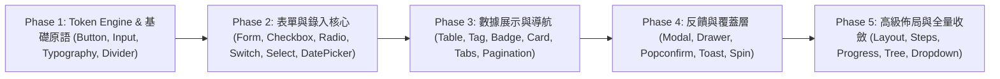

# 跨對話 Agent 任務執行包（Agent Task Batches）

本文檔將 Ant Design Reborn 的實作流程拆分為各個獨立、模組化的階段工作單。
未來您在開啟新的對話時，只需**複製對應階段的 Prompt 任務卡**交給 Agent，Agent 即可在充分理解前置規格的前提下，循序漸進接力完成對應組件與測試。

---

## 任務推進地圖（Milestones Overview）



---

## 階段任務卡與 Agent Prompt 模板

### 📌 Phase 1：Token 引擎與基礎原語（Button / Input / Typography / Divider）

> **前置依賴準備**：安裝 `react-aria-components`, `class-variance-authority`, `clsx`, `tailwind-merge`, `lucide-react`。卸載 `antd` 與 `dayjs`。

#### 給 Agent 的 Prompt 任務指令：

```markdown
@docs/ARCHITECTURE.md @docs/COMPONENT_AUTHORING_GUIDE.md @docs/COMPONENTS_MATRIX.md
請為我執行「Phase 1：Token 引擎與基礎原語」落地任務：

1. 依賴整理：
   - 卸載 antd 與 dayjs
   - 安裝 react-aria-components, class-variance-authority, clsx, tailwind-merge, lucide-react
2. 在 src/global.css 中建立基於 CSS color-mix() 的完整 Antd Design Token 體系與 Button Wave 動效 Keyframes。
3. 在 src/lib/utils.ts 中提供 cn() 類名合併函數。
4. 在 src/components/ui/ 實作以下基礎組件（嚴格遵照編寫指南，不硬編碼顏色）：
   - button.tsx (包含水波紋 .ant-btn-wave、Primary/Default/Dashed/Text/Link 變體、Danger 態、加載狀態)
   - input.tsx (包含 Focus 藍色外光暈、前後綴圖標、一鍵清除按鈕)
   - typography.tsx (Title, Text, Paragraph 語義排版)
   - divider.tsx (水平/垂直、實線/虛線、帶標題分割線)
5. 在 test/ 目錄編寫 Chromium 單元測試，驗證按鈕與輸入框的真實樣式與互動。
6. 執行 vpr agent:verify:gate 確保全數通過，並更新 docs/COMPONENTS_MATRIX.md 中的勾選狀態。
```

---

### 📌 Phase 2：數據錄入與表單核心（Form / Checkbox / Radio / Switch / Select / DatePicker）

> **前置依賴準備**：安裝 `@tanstack/react-form`, `@tanstack/zod-form-adapter`, `zod`, `@internationalized/date`。

#### 給 Agent 的 Prompt 任務指令：

```markdown
@docs/ARCHITECTURE.md @docs/COMPONENT_AUTHORING_GUIDE.md @docs/COMPONENTS_MATRIX.md
請為我執行「Phase 2：數據錄入與表單核心」落地任務：

1. 安裝必要套件：@tanstack/react-form, @tanstack/zod-form-adapter, zod, @internationalized/date。
2. 在 src/components/ui/ 實作以下數據錄入組件：
   - form/ (整合 TanStack Form，提供 Antd 經典垂直/水平排版、必填星號、錯誤滑入提示，原生相容 React 19 Actions)
   - checkbox.tsx (方框選中動效、半選態 Indeterminate、CheckboxGroup)
   - radio.tsx (經典圓點選中動效、RadioGroup、按鈕樣式單選)
   - switch.tsx (膠囊型滑塊、內部圖標/文字、加載狀態)
   - select.tsx (基於 react-aria-components，單選/搜尋過濾、勾選圖示、下拉微動效)
   - date-picker.tsx (基於 react-aria-components + @internationalized/date，經典日曆網格、今天按鈕、原生 Intl 雙向文字支援)
3. 在 test/ 目錄編寫表單與選擇器的 Chromium 互動測試。
4. 執行 vpr agent:verify:gate 確保全數通過，並更新 docs/COMPONENTS_MATRIX.md 中的勾選狀態。
```

---

### 📌 Phase 3：數據展示與導航核心（Table / Tag / Badge / Card / Tabs / Pagination）

> **前置依賴準備**：安裝 `@tanstack/react-table`。

#### 給 Agent 的 Prompt 任務指令：

```markdown
@docs/ARCHITECTURE.md @docs/COMPONENT_AUTHORING_GUIDE.md @docs/COMPONENTS_MATRIX.md
請為我執行「Phase 3：數據展示與導航核心」落地任務：

1. 安裝必要套件：@tanstack/react-table。
2. 在 src/components/ui/ 實作以下組件：
   - table/ (以 @tanstack/react-table 為內核，提供 Antd 經典緊湊邊框、表頭排序小箭頭、多列固定、選取 Checkbox、條紋模式)
   - pagination.tsx (頁碼按鈕組、快速跳轉、每頁筆數下拉，並能與 Table 無縫連動)
   - tag.tsx (Preset 色彩體系：藍/綠/橘/紅/灰、可關閉態、CheckableTag)
   - badge.tsx (經典小紅點、數字角標、Processing 呼吸擴散波紋動畫)
   - card.tsx (經典邊框、右上角操作區、封面圖與網格排版)
   - tabs.tsx (基於 react-aria-components，底部藍條平滑滑動指示器、卡片模式)
3. 在 test/ 目錄編寫 Table 排序與分頁的單元測試。
4. 執行 vpr agent:verify:gate 確保全數通過，並更新 docs/COMPONENTS_MATRIX.md 中的勾選狀態。
```

---

### 📌 Phase 4：反饋與覆蓋層（Modal / Drawer / Popconfirm / Message / Spin）

#### 給 Agent 的 Prompt 任務指令：

```markdown
@docs/ARCHITECTURE.md @docs/COMPONENT_AUTHORING_GUIDE.md @docs/COMPONENTS_MATRIX.md
請為我執行「Phase 4：反饋與覆蓋層組件」落地任務：

1. 在 src/components/ui/ 實作以下反饋組件：
   - modal.tsx (基於 react-aria-components Dialog，中心縮放淡入 Scale-In 動效、遮罩模糊、Focus Trap、提供 confirm() 命令式彈窗)
   - drawer.tsx (基於 react-aria-components ModalOverlay，左右上下四向滑入抽屜、關閉按鈕)
   - popconfirm.tsx (氣泡確認框、確認/取消雙按鈕、確認回調)
   - message.tsx (頁面頂部滑入 Toast 反饋提示、成功/錯誤/警告圖示、自帶倒數計時關閉)
   - spin.tsx (SVG 旋轉加載菊花、區域遮罩 Loading 容器)
   - alert.tsx (四色警告提示條、帶圖示、可關閉、自訂輔助文字)
2. 在 test/ 目錄編寫 Modal 開啟、焦點鎖定與 Popconfirm 點擊確認測試。
3. 執行 vpr agent:verify:gate 確保全數通過，並更新 docs/COMPONENTS_MATRIX.md 中的勾選狀態。
```

---

### 📌 Phase 5：進階佈局與全量收斂（Layout / Steps / Progress / Tree / 全景 Canary）

#### 給 Agent 的 Prompt 任務指令：

```markdown
@docs/ARCHITECTURE.md @docs/COMPONENT_AUTHORING_GUIDE.md @docs/COMPONENTS_MATRIX.md
請為我執行「Phase 5：進階佈局與全量收斂」落地任務：

1. 在 src/components/ui/ 實作以下進階組件：
   - layout/ (Layout, Header, Sider, Content, Footer 經典後台骨架、側邊欄折疊收縮)
   - steps.tsx (水平/垂直步驟條、圓點與圖示狀態)
   - progress.tsx (圓環與橫條進度條、動態漸層色)
   - tree.tsx (樹形控件、展開/折疊節點、複選框多選)
   - popover.tsx, tooltip.tsx (黑色經典提示小浮層)
2. 重構 src/routes/canary.tsx，呈現全組件展示矩陣，支援頂層即時調節主色，確認所有組件和諧連動。
3. 執行 vpr agent:verify:gate 通過全流程測試，確保所有 60+ 組件在 docs/COMPONENTS_MATRIX.md 均達到 Completed 狀態。
```
